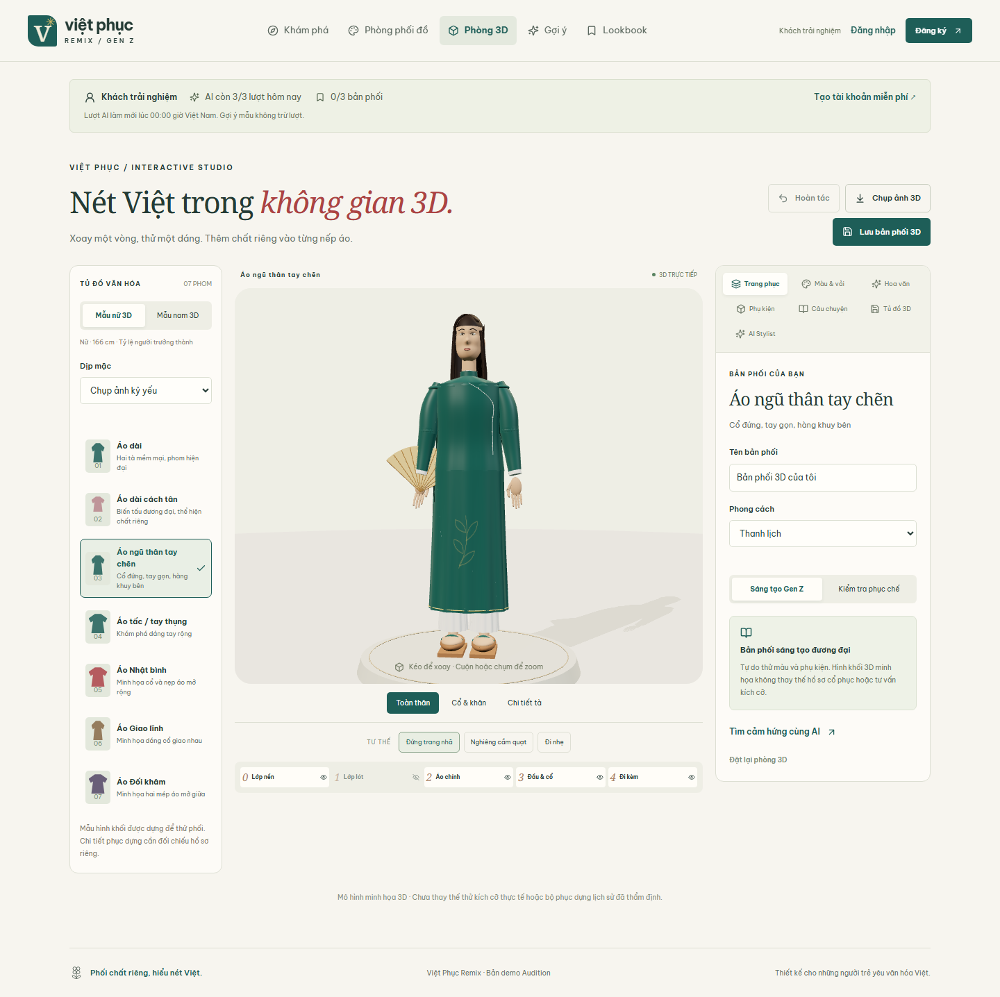
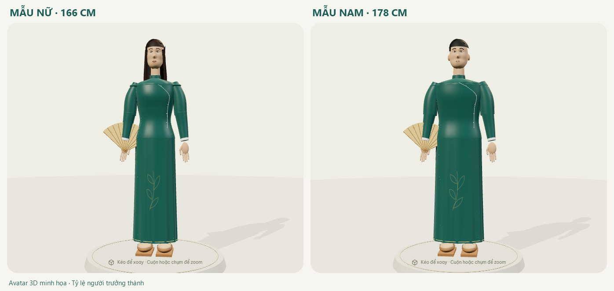

# Phòng phối cổ phục 3D

Phòng 3D mở rộng Việt Phục Remix hiện có. Đây là bản phối trên mannequin minh họa, không phải đo cơ thể hoặc bảo đảm trang phục ngoài đời sẽ vừa người mặc.

## Chạy trên máy

Tại thư mục gốc dự án, dùng Node.js 22 trở lên:

```bash
npm ci
npm run dev
```

Mở địa chỉ frontend do Vite in ra, sau đó chọn **Phòng 3D** trên thanh điều hướng. Cần bật tăng tốc đồ họa và WebGL trong trình duyệt để xem mô hình. Các chức năng tài khoản và tủ đồ vẫn cần backend đang chạy.

## Thử bản demo

1. Chọn **Mẫu nữ 3D** hoặc **Mẫu nam 3D**, rồi chọn một trong bảy phom áo ở tủ đồ bên trái.
2. Kéo trên mẫu để xoay, cuộn/chụm để zoom; dùng **Toàn thân**, **Cổ & khăn** hoặc **Chi tiết tà** để đổi góc nhìn.
3. Mở **Màu & vải** để chọn bốn màu riêng và preset lụa, sa, gấm hoặc đoạn.
4. Mở **Hoa văn** để chọn mẫu, vị trí viền, vẽ nét riêng hoặc dùng trình trang trí. Trình trang trí sử dụng bản phác 2D; kết quả được ánh xạ lên bề mặt áo 3D, nên vị trí là minh họa theo UV.
5. Mở **Phụ kiện** để phối khăn, vòng cổ, quạt, túi, giày hoặc nón. Nón lá được cầm bên dưới, giúp nhìn rõ khăn vấn.
6. Chạm vào áo trên cảnh để mở **Câu chuyện**. **Kiểm tra phục chế** hiện tình trạng chưa đủ tư liệu chứng nhận của mô hình.
7. Mở **AI Stylist**, nhập mong muốn và tạo gợi ý. Chọn **Áp dụng gợi ý 3D** để đổi trực tiếp trên cảnh; nếu đã sửa mẫu trong lúc chờ, cần tạo lại gợi ý.
8. Đặt tên và **Lưu bản phối 3D**. Mở lại ở **Tủ đồ 3D**, chỉnh rồi **Cập nhật bản phối**. **Chụp ảnh 3D** tải PNG về máy.



## Mô hình và phạm vi

Các phom được dựng bằng hình học Three.js ngay trong ứng dụng: ngũ thân tay chẽn, ngũ thân tay thụng/áo tấc, Nhật bình, Giao lĩnh, Đối khâm, áo dài và áo dài cách tân. Hai preset mannequin nam/nữ giúp xem bản phối theo các tỷ lệ minh họa khác nhau.

### Hình thể người trưởng thành

- Preset nữ có chiều cao minh họa 166 cm; nam 178 cm. Đây là lựa chọn thiết kế, không phải một chuẩn duy nhất cho mọi người.
- Đầu, cổ, vai, ngực, eo, hông và chân được đặt theo tỷ lệ người trưởng thành; chiều cao mẫu khoảng 7,4 lần chiều cao mesh đầu. Tóc và khăn có thể tăng chiều cao nhìn thấy.
- Nam có vai rộng và đường eo vừa phải; nữ có phom ngực–eo–hông riêng. Áo dài ôm nhẹ theo hình thể, ngũ thân và áo rộng giữ độ dư vải.
- Khuôn mặt dùng một bề mặt liên tục với hàm, má, trán và mũi; bàn tay có năm ngón. Khuỷu tay là khớp riêng để nâng quạt; phụ kiện đi theo khớp thay vì đứng tách khỏi tay.
- Toàn bộ người, áo và phụ kiện được scale cùng nhau; camera đổi khung theo chiều cao mẫu. Lớp áo trong được che hoặc thu vào bên trong áo chính để giảm xuyên bề mặt.

Tham khảo thị giác từ [mẫu nữ áo dài của LittleShirt263](https://sketchfab.com/3d-models/vietnamese-ao-dai-woman-3d-model-9d75210513b944f8961a4d0a7a20731a) và [mẫu nam của C1_DDT](https://sketchfab.com/3d-models/dongphuc-nam-pa1-63a34621c0cc4a9aa2ff0c0aa9ba6cf6). Dự án dựng geometry riêng, không nhúng hoặc sao chép tài nguyên mô hình từ hai trang này.



Pipeline asset GLB production xem [tài liệu GLB và rigging](FITTING_3D_GLTF.md).

Mô hình hiện tại không phải quét hiện vật, asset do nghệ nhân duyệt hay bộ rập may. Tên phom giúp tổ chức trải nghiệm thử màu và phụ kiện; không tự xác nhận độ chính xác lịch sử của mọi chi tiết hình học.

## Dữ liệu, tài khoản và AI

Bản phối dùng `schemaVersion: "fitting-3d/1"`, được kiểm tra bằng Zod trong `backend/src/fitting3d/model.ts`. Các trường chính:

| Trường | Giá trị lưu |
|---|---|
| `revision` | Phiên bản chỉnh sửa tại phòng phối; dùng phát hiện gợi ý AI đã cũ |
| `gender`, `garmentId` | Preset mannequin và một trong bảy phom áo |
| `eventId`, `styleId`, `mode` | Sự kiện, phong cách, sáng tạo hoặc phục chế |
| `colors` | Bốn màu HEX: áo, quần, lớp lót, hoa văn |
| `fabric` | `silk`, `gauze`, `brocade`, `satin` |
| `layers` | Bật/tắt nền, lót, áo chính, phụ kiện đầu, phụ kiện ngoài |
| `accessories`, `pattern` | ID phụ kiện và cấu hình họa tiết hiện có |
| `pose`, `camera` | Preset tư thế và góc nhìn |

`storageVersion` là phiên bản riêng của bản ghi trong tủ đồ, dùng chống ghi đè giữa các tab. Nó không phải `revision` của quá trình chỉnh sửa.

| API | Hành vi |
|---|---|
| `GET /api/fitting3d/scene` | Danh mục và trạng thái mẫu mặc định |
| `GET /api/fitting3d/outfits` | Tủ đồ 3D của phiên hiện tại và hạn mức tài khoản |
| `POST /api/fitting3d/outfits` | Tạo bản phối từ `{ title, outfit }` |
| `PUT /api/fitting3d/outfits/:id` | Cập nhật bằng `{ title, outfit, storageVersion }`; trả `409` khi phiên bản lưu đã cũ |
| `DELETE /api/fitting3d/outfits/:id` | Xóa bản phối thuộc tài khoản hiện tại |
| `POST /api/fitting3d/stylist` | Nhận `{ outfit, prompt, requestId }`; trả gợi ý có `baseRevision`, `requestId`, `source`, `suggestions` và phiên tài khoản |

Tất cả thao tác thay đổi yêu cầu phiên hợp lệ và CSRF token như các chức năng hiện có. Backend chỉ nhận các ID/phụ kiện/màu đúng danh mục; người dùng không gửi mã Three.js, URL asset hoặc shader để máy chủ thực thi.

Tủ đồ 2D và 3D **dùng chung hạn mức**: khách tối đa ba bản phối, thành viên tối đa 100. AI 3D dùng chung ba lượt AI/ngày của khách với gợi ý 2D và tạo họa tiết; chỉ kết quả Gemini thành công mới trừ lượt. Đăng ký/đăng nhập chuyển bản phối khách theo cơ chế tủ đồ hiện có.

AI chỉ gợi ý màu, chất liệu, phụ kiện và pose; giữ phom áo, mannequin, sự kiện, chế độ, các lớp, góc nhìn và họa tiết tự vẽ. Backend kiểm tra cấu trúc và các trường được bảo vệ. Nếu không có key hoặc kết quả không hợp lệ, hệ thống trả gợi ý mẫu với nhãn rõ ràng và không trừ lượt AI.

Để bật Gemini, cấu hình `GEMINI_API_KEY` và `GEMINI_MODEL` ở môi trường **backend**, sau đó khởi động lại backend. Không đặt key trong biến `VITE_*`, frontend hoặc tệp được commit. Model khả dụng phụ thuộc tài khoản nhà cung cấp.

## Văn hóa và nguồn

Chế độ sáng tạo dành cho các bản phối đương đại. Chế độ phục chế phải phản ánh tình trạng bằng chứng của mẫu, không tự cấp chứng nhận từ tên áo, tên triều đại hay phản hồi AI. Mẫu chưa có hồ sơ phục dựng được duyệt phải được ghi rõ là chưa kiểm chứng.

Các nguồn tham khảo đọc thêm:

- [Bảo tàng Lịch sử quốc gia — Tiếp nhận áo dài ngũ thân truyền thống](https://baotanglichsu.vn/vi/Articles/3090/72685/bao-tang-lich-su-quoc-gia-tiep-nhan-ao-dai-ngu-than-truyen-thong.html): mô tả một mẫu ngũ thân sa kép do nghệ nhân đương đại may; không phải quy định cho mọi ngũ thân lịch sử.
- [Bảo tàng Phụ nữ Nam Bộ — Áo dài ngũ thân, hành trình trở lại](https://baotangphunu.com/4266-2/): tay hẹp/tay thụng và những thay đổi trong thực hành hiện nay.
- [Bảo tàng Lịch sử quốc gia — Trang phục cung đình triều Nguyễn](https://baotanglichsu.vn/vi/Articles/3096/18303/trang-phuc-cung-djinh-trieu-nguyen.html): tư liệu tham khảo về trang phục theo địa vị và hoàn cảnh; cần thẩm định riêng trước khi biến thành ràng buộc phục chế.

Thiết kế dài hạn và các hợp đồng đề xuất nằm tại [bản thiết kế tổng thể](design/3d-fitting-room/DESIGN.md). Những ví dụ trong thư mục thiết kế không phải API đang chạy của bản MVP.

## Giới hạn kỹ thuật

- Chuyển động và độ rủ là minh họa lập trình, chưa có mô phỏng vải vật lý nhiều lớp, xử lý va chạm toàn diện hoặc bảo đảm mọi góc nhìn không xuyên áo.
- Chưa có pipeline GLB theo hiện vật, Draco/KTX2, thư viện asset được kiểm chứng hay bộ rập cho từng số đo.
- Các tham số vật liệu là lựa chọn mỹ thuật. Chưa có phép đo quang học của lụa, sa, gấm hoặc đoạn để hiệu chỉnh shader.
- Chưa công bố benchmark đạt 60 FPS, thời gian tải hoặc mức dưới 8 MB trên mọi thiết bị. Kiểm thử chức năng không thay thế đo hiệu năng trên máy thật.
- Không có thanh toán, tồn kho, thử đồ bằng ảnh người thật hoặc chứng nhận phục dựng lịch sử trong bản này.
- SQLite vẫn theo cấu hình lưu trữ của backend. Seed dữ liệu không biến filesystem tạm của nhà cung cấp thành kho dữ liệu bền vững.

## Kiểm tra

```bash
npm run build
npm test
npx tsx --test frontend/src/features/fitting3d/engine/anatomy.test.ts
npx tsx --test frontend/src/features/fitting3d/engine/anatomy.test.ts
npx tsx --test frontend/src/features/fitting3d/engine/modular/ModularWardrobe.test.ts
npx playwright test tests/fitting3d.spec.ts
```

Playwright dùng API riêng với SQLite trong bộ nhớ và nhà cung cấp AI giả lập; không sử dụng API key hoặc database tài khoản thật. Kiểm thử mô phỏng viewport điện thoại không thay thế thử trên thiết bị di động thật.


